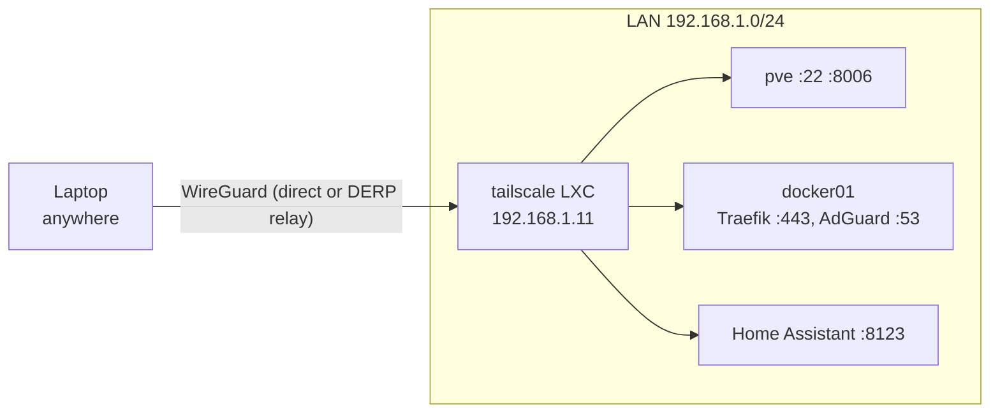

# 06 Remote access

I want to reach the server from my laptop when I am not at home: SSH to the
hosts, the Proxmox UI, and Grafana. Nothing on the router is forwarded to the
LAN, and that stays the same. Remote access goes through Tailscale, a
WireGuard-based VPN, with one small container on the Proxmox host acting as
the gateway into the LAN.

## Layout

| Component | Where | Address |
|-----------|-------|---------|
| Tailscale subnet router | LXC 110 `tailscale` on pve, Debian 13 | `192.168.1.11` |
| Tailscale client | MacBook | tailnet address |
| Access policy | Tailscale admin console | [`tailscale/policy.hujson`](../tailscale/policy.hujson) |



## How it works

Each device in the tailnet has its own WireGuard key pair. Tailscale's
coordination server only hands out public keys and endpoints. Traffic goes
directly between devices when NAT allows it, and through Tailscale's DERP
relays over TCP 443 when it does not, so it also works on restricted networks
at work or school. Either way it is encrypted end to end.

Only the gateway container runs Tailscale. It advertises the route
`192.168.1.0/24` to the tailnet, so the laptop sends traffic for LAN addresses
to it, and the container forwards it into the LAN. The hosts on the LAN need no
changes because the container source-NATs the traffic, so to them it comes from
`192.168.1.11`.

## The gateway container

An unprivileged LXC container, created on pve with:

```bash
pct create 110 local:vztmpl/debian-13-standard_13.6-1_amd64.tar.zst \
  --hostname tailscale --cores 1 --memory 512 --swap 512 \
  --rootfs local-lvm:4 \
  --net0 name=eth0,bridge=vmbr0,ip=192.168.1.11/24,gw=192.168.1.1 \
  --nameserver 192.168.1.1 --searchdomain home.arpa \
  --unprivileged 1 --features nesting=1 \
  --dev0 /dev/net/tun \
  --ssh-public-keys /root/.ssh/authorized_keys \
  --onboot 1 --start 1
```

`--dev0 /dev/net/tun` passes the TUN device into the container. Tailscale needs
it to create its network interface, and an unprivileged container does not get
it by default.

The container uses the router for DNS, not AdGuard, so remote access keeps
working when docker01 is down. That is exactly when I would need it.

Why a separate container and not Tailscale on an existing machine:

- Not on the Proxmox host, because the hypervisor should run as little extra
  software as possible.
- Not on docker01, because remote access should not depend on the Docker stack.

Inside the container:

```bash
curl -fsSL https://tailscale.com/install.sh | sh

cat > /etc/sysctl.d/99-tailscale.conf <<'CONF'
net.ipv4.ip_forward = 1
net.ipv6.conf.all.forwarding = 1
CONF
sysctl -p /etc/sysctl.d/99-tailscale.conf

tailscale up --advertise-routes=192.168.1.0/24 --accept-dns=false
```

The install script adds Tailscale's apt repository, so updates come with
`apt upgrade`. IP forwarding lets the kernel pass packets from the Tailscale
interface to `eth0`. `--accept-dns=false` keeps the container on the router's
DNS.

In the admin console I approved the route and disabled key expiry for this
machine. Without that, the node key expires after 180 days and remote access
stops, most likely while I am away.

## DNS

Addresses worked remotely at this point, but names under `home.arpa` did not,
because away from home the laptop asks the mobile network's DNS server.

The fix is split DNS: in the admin console, under DNS, a custom nameserver
`192.168.1.20` restricted to the domain `home.arpa`. Only queries for that
domain go through the tunnel to AdGuard. Everything else uses the normal
resolver, so the internet still works on the laptop when the home connection
is down.

On macOS, `dig` talks to DNS servers directly and ignores this setting. To test
what applications actually see:

```bash
dscacheutil -q host -a name grafana.home.arpa
```

## Access policy

The default tailnet policy allows every device to reach everything. It is
replaced by [`tailscale/policy.hujson`](../tailscale/policy.hujson):

- My devices may reach `192.168.1.0/24` on the ports I use (SSH, HTTP/HTTPS
  through Traefik, Proxmox, Home Assistant, DNS) and ICMP. Everything else is
  denied.
- The gateway has the tag `tag:subnet-router`. A tagged device is owned by the
  tailnet instead of my user account, and key expiry is turned off for it
  automatically.
- `autoApprovers` approves the LAN route when it comes from a device with that
  tag, so a rebuilt gateway works without a manual step.

The policy is edited in the admin console. The copy in this repository is the
reference version and is kept in sync by hand.

## Testing

Testing from home proves nothing, because the laptop reaches the LAN directly.
All tests were run with the laptop on a phone hotspot:

```bash
ping -c2 192.168.1.10            # ttl=63: one hop through the gateway
ssh pve hostname                 # pve
curl -sk -o /dev/null -w '%{http_code}\n' https://192.168.1.10:8006           # 200
curl -sk -o /dev/null -w '%{http_code}\n' https://grafana.home.arpa/api/health # 200
nc -vz -G 3 192.168.1.10 3128    # times out
```

The last test checks the policy. Port 3128 is Proxmox's SPICE proxy, open on
the LAN but not granted in the policy, so remotely it must time out.

## Problems I ran into

**Commands run on the wrong host.** The install commands for the container are
run inside it (`pct enter 110`, prompt `root@tailscale`). I nearly ran them on
pve itself. Checking the prompt before pasting is the simple fix.

**`eth0` down right after creation.** Checking the network immediately after
`pct create --start 1` showed `eth0` as `DOWN` with no address. A few seconds
later it was up. The container's network service had not finished starting.

## Still to do

- Join the gateway with an auth key from Ansible Vault instead of a browser
  login, so it can be rebuilt by a playbook
- Keep the access policy in Git and apply it with Tailscale's GitOps action
- Trust the local CA on the MacBook
- Monitor the gateway container
